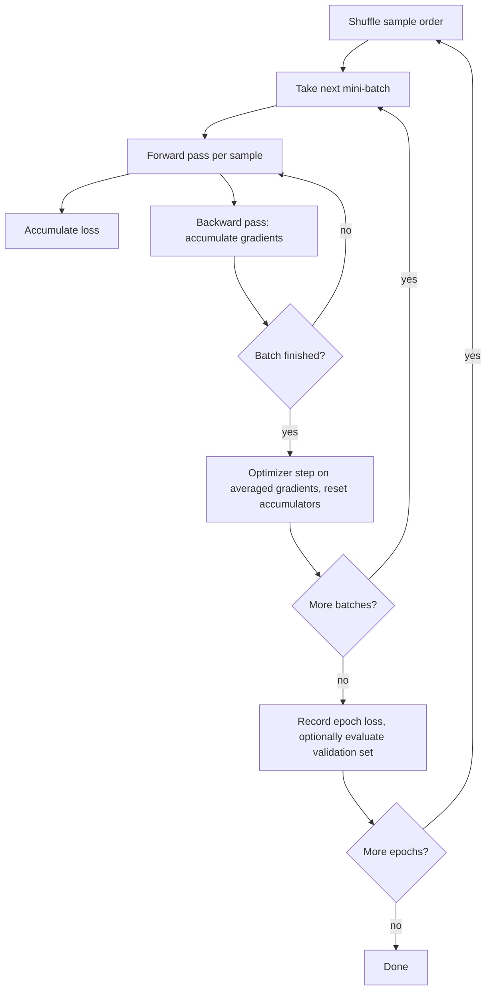

# neural-network-cpp

**A dependency-free, header-only feedforward neural network written from scratch in modern C++17 — built to be read, verified, and learned from.**

[](https://github.com/milad10101010/neural-network-cpp/actions/workflows/ci.yml)


[](LICENSE)

Every step of a neural network — forward propagation, backpropagation, weight initialisation, loss functions and optimizers — is implemented explicitly in a few hundred lines with **no external libraries**, no BLAS, and no code generation. The result trains real models: **97.69% test accuracy on MNIST** in about a minute on a single CPU thread.

```cpp
#include "nn/neural_network.hpp"

nn::NeuralNetwork net({784, 128, 64, 10}, nn::Loss::CategoricalCrossEntropy, /*seed=*/42);

nn::TrainConfig cfg;
cfg.optimizer    = nn::Optimizer::Adam;
cfg.learningRate = 0.001;
cfg.epochs       = 10;
cfg.batchSize    = 64;

net.train(trainSet, cfg, &testSet);
std::cout << net.evaluate(testSet).accuracy;   // 0.9769 on MNIST
```

---

## Table of contents

- [Why this project](#why-this-project)
- [Features](#features)
- [Quick start](#quick-start)
- [Usage guide](#usage-guide)
- [Results](#results)
- [Training on MNIST](#training-on-mnist)
- [How it works (the math)](#how-it-works-the-math)
- [Design decisions](#design-decisions)
- [API reference](#api-reference)
- [Testing and correctness](#testing-and-correctness)
- [Comparison with PyTorch](#comparison-with-pytorch)
- [Project structure](#project-structure)
- [Limitations](#limitations)
- [Roadmap](#roadmap)
- [Contributing](#contributing)
- [License and acknowledgements](#license-and-acknowledgements)

---

## Why this project

Frameworks such as PyTorch and TensorFlow are excellent, but they hide the mechanics behind autograd and optimized kernels. This repository does the opposite: it keeps the whole pipeline in plain C++ so you can read the exact code that computes a gradient and applies an update.

It is built around three principles:

1. **Readable.** One forward implementation, one backward implementation, one optimizer routine. No macros, no template metaprogramming.
2. **Verifiable.** Backpropagation is checked against numerical finite differences for every supported loss/activation pairing, and the test suite runs under AddressSanitizer and UBSan in CI.
3. **Honest.** It is an educational and prototyping library, not a replacement for production frameworks. See [Limitations](#limitations).

## Features

| Area | What is included |
|---|---|
| **Architecture** | Arbitrary depth: `NeuralNetwork({2, 64, 32, 3})` builds any number of fully connected layers |
| **Activations** | ReLU (hidden); Sigmoid, Softmax or Linear (output); numerically stable Sigmoid and Softmax |
| **Losses** | Binary Cross-Entropy, Categorical Cross-Entropy, Mean Squared Error |
| **Optimizers** | SGD, SGD with Momentum, Adam; optional L2 weight decay |
| **Training** | Mini-batch gradient descent, per-epoch shuffling, optional validation set, per-epoch loss history |
| **Initialisation** | He initialisation for ReLU layers, Xavier/Glorot for the output layer |
| **Reproducibility** | Explicit `seed` controls initialisation and shuffling: same seed gives bit-identical training |
| **Evaluation** | Loss and accuracy (`evaluate`), class prediction (`predictClass`), train/test splitting |
| **Verification** | Built-in numerical `gradientCheck()` |
| **Persistence** | `save()` / `load()` in a human-readable text format with full `double` precision |
| **Data** | MNIST IDX loader, plus synthetic datasets: circle, XOR, multi-class spiral |
| **Memory layout** | Contiguous row-major `Matrix` (cache friendly) |
| **Tooling** | CMake, CTest, GitHub Actions CI (Linux, macOS, Windows, sanitizers) |

## Quick start

**Requirements:** a C++17 compiler and CMake 3.14+ (CMake is optional; the library is just headers). Developed and tested with GCC on Linux; the CI workflow also builds with Clang (macOS) and MSVC (Windows).

```bash
git clone https://github.com/milad10101010/neural-network-cpp.git
cd neural-network-cpp

cmake -S . -B build -DCMAKE_BUILD_TYPE=Release
cmake --build build --parallel
(cd build && ctest --output-on-failure)       # run the test suite

./build/binary_classification      # gradient check + XOR + circle
./build/spiral_multiclass          # Softmax + optimizer comparison
```

Without CMake, compile any example directly:

```bash
g++ -std=c++17 -O2 -Iinclude -o spiral examples/spiral_multiclass.cpp && ./spiral
```

### Using it in your own project

**Option 1: copy the headers.** Copy `include/nn/` into your tree and `#include "nn/neural_network.hpp"`.

**Option 2: CMake `FetchContent`.**

```cmake
include(FetchContent)
FetchContent_Declare(nn
  GIT_REPOSITORY https://github.com/milad10101010/neural-network-cpp.git
  GIT_TAG        v1.0.0)
FetchContent_MakeAvailable(nn)

target_link_libraries(my_app PRIVATE nn::nn)
```

Examples and tests are only built when this repository is the top-level project, so consuming it stays lightweight.

## Usage guide

### Binary classification

```cpp
#include "nn/datasets.hpp"
#include "nn/neural_network.hpp"

std::mt19937_64 rng(42);
auto all = nn::datasets::makeCircle(2000, rng);
auto [train, test] = nn::datasets::trainTestSplit(all, /*testRatio=*/0.2, rng);

nn::NeuralNetwork net({2, 16, 8, 1}, nn::Loss::BinaryCrossEntropy, /*seed=*/42);

nn::TrainConfig cfg;
cfg.learningRate = 0.01;
cfg.epochs = 300;
net.train(train, cfg, &test);

nn::Metrics m = net.evaluate(test);          // m.loss, m.accuracy
double p = net.predict({0.5, 0.5})[0];       // probability of "inside the circle"
```

### Multi-class classification

Targets are one-hot vectors. `Loss::CategoricalCrossEntropy` automatically selects a Softmax output layer.

```cpp
nn::NeuralNetwork net({2, 64, 32, 3}, nn::Loss::CategoricalCrossEntropy, 42);
net.train(train, cfg);

std::size_t label = net.predictClass({0.3, -0.2});      // argmax of the probabilities
std::vector<double> probs = net.predict({0.3, -0.2});   // sums to 1
```

### Regression

```cpp
nn::NeuralNetwork net({1, 32, 32, 1}, nn::Loss::MeanSquaredError);  // Linear output
```

### Choosing an optimizer and regularisation

```cpp
nn::TrainConfig cfg;
cfg.optimizer    = nn::Optimizer::Momentum;   // SGD | Momentum | Adam
cfg.learningRate = 0.02;
cfg.momentum     = 0.9;
cfg.weightDecay  = 1e-4;                      // L2 penalty on weights (not biases)
cfg.batchSize    = 64;
cfg.shuffle      = true;
```

### Saving and loading a model

```cpp
net.save("model.txt");
nn::NeuralNetwork restored = nn::NeuralNetwork::load("model.txt");   // identical predictions
```

The file stores the architecture, loss, output activation and all parameters at full precision.

### Verifying your own architecture

```cpp
double err = net.gradientCheck(sampleInput, sampleTarget);   // expect < 1e-6
```

## Results

All numbers below were produced by the code in this repository (seed 42, single thread, CMake Release build). Timings depend on your hardware.

| Task | Architecture | Setup | Result |
|---|---|---|---|
| Gradient check (BCE) | `{3,5,4,1}` | backprop vs. central differences | max relative error ≈ 8.6e-11 |
| XOR (4 samples) | `{2,8,1}` | Adam, lr 0.05, batch 4, 1000 epochs | 100% accuracy |
| Circle (1600 train / 400 test) | `{2,16,8,1}` | Adam, lr 0.01, batch 32, 300 epochs | 99.50% train, **98.50% test** |
| MNIST (60k train / 10k test) | `{784,128,64,10}` | Adam, lr 0.001, batch 64, 10 epochs | **97.69% test** in ~63 s |

> **About XOR:** the problem has only four samples, so train and test are the same data. The 100% shows the network can represent XOR, not that it generalises. The circle and MNIST tasks measure generalisation.

### Optimizer comparison (3-class spiral, 720 train / 180 test, 200 epochs)

| Optimizer | Learning rate | Train accuracy | Test accuracy | Test loss |
|---|---|---|---|---|
| SGD | 0.05 | 99.58% | 97.78% | 0.0466 |
| Momentum (μ = 0.9) | 0.02 | 99.17% | 97.22% | 0.0523 |
| Adam | 0.01 | 99.72% | **98.89%** | **0.0226** |

Reproduce with `./build/spiral_multiclass 42`. The test set is small (180 samples), so differences of one or two percentage points are within noise; treat the table as an illustration, not a benchmark.

## Training on MNIST

1. Download the four MNIST files and decompress them into one directory. The original host has been unreliable, so use any mirror you trust. For example:

   ```bash
   mkdir -p data/mnist && cd data/mnist
   BASE=https://github.com/golbin/TensorFlow-MNIST/raw/master/mnist/data
   for f in train-images-idx3-ubyte train-labels-idx1-ubyte \
            t10k-images-idx3-ubyte  t10k-labels-idx1-ubyte; do
     curl -L -O $BASE/$f.gz && gunzip -f $f.gz
   done
   cd ../..
   ```

2. Train:

   ```bash
   ./build/mnist_example data/mnist 10        # <dir> [epochs] [train_limit] [seed]
   ```

   Sample output (seed 42):

   ```
   train: 60000 samples, test: 10000 samples
   parameters: 109386

   epoch    1/10 | train loss 0.26302 | val loss 0.13609 | val acc 95.74%
   epoch    5/10 | train loss 0.04467 | val loss 0.08412 | val acc 97.39%
   epoch   10/10 | train loss 0.01834 | val loss 0.08100 | val acc 97.69%

   training time: 63 s
   test accuracy: 97.69%
   reloaded model test accuracy: 97.69%  [identical]
   ```

Notes on interpreting this result:

- The example reports test accuracy after every epoch for monitoring only; no hyperparameter search or early stopping was done. Accuracy fluctuates by a few tenths of a percent between epochs (97.33% to 97.93% over epochs 7 to 10), so expect the final number to vary slightly with the seed.
- The trained model is saved to `mnist_model.txt` and reloaded to confirm that persistence is exact.

## How it works (the math)

Let a network have layers $l = 1,\dots,L$ with weights $W^{(l)}$ and biases $b^{(l)}$. The input is $a^{(0)} = x$.

### Forward propagation

$$z^{(l)} = W^{(l)} a^{(l-1)} + b^{(l)}, \qquad a^{(l)} = f_l\!\left(z^{(l)}\right)$$

Hidden layers use ReLU, $f(z) = \max(0, z)$. The output layer uses one of:

| Output | Formula | Typical use |
|---|---|---|
| Sigmoid | $\sigma(z) = \dfrac{1}{1 + e^{-z}}$ | binary classification |
| Softmax | $\dfrac{e^{z_j - \max z}}{\sum_k e^{z_k - \max z}}$ | multi-class classification |
| Linear | $z$ | regression |

Subtracting $\max z$ in Softmax and branching on the sign in Sigmoid keep `exp()` from overflowing.

### Loss functions (per sample, $\hat y$ = network output, $y$ = target)

| Loss | Definition |
|---|---|
| Binary Cross-Entropy | $-\sum_j \left[y_j \log \hat y_j + (1 - y_j)\log(1 - \hat y_j)\right]$ |
| Categorical Cross-Entropy | $-\sum_j y_j \log \hat y_j$ |
| Mean Squared Error | $\tfrac{1}{2}\sum_j (\hat y_j - y_j)^2$ |

Probabilities are clamped to $[10^{-12},\,1 - 10^{-12}]$ before taking logarithms.

### Backpropagation

The error signal at the output is $\delta^{(L)} = \partial \mathcal{L} / \partial z^{(L)}$. For the three natural loss/activation pairings it collapses to the same simple form:

$$\delta^{(L)} = \hat y - y \qquad \text{(Sigmoid + BCE, Softmax + CCE, Linear + MSE)}$$

This is why those pairings are the defaults: there is no extra activation derivative to saturate, which avoids the vanishing-gradient problem that Sigmoid + MSE suffers from. (Sigmoid + MSE is still supported and uses $\delta^{(L)} = (\hat y - y)\,\hat y\,(1 - \hat y)$.)

The error is then propagated backwards through the layers:

$$\delta^{(l)} = \left(W^{(l+1)\top}\, \delta^{(l+1)}\right) \odot f'\!\left(z^{(l)}\right)$$

and the parameter gradients are

$$\frac{\partial \mathcal{L}}{\partial W^{(l)}} = \delta^{(l)}\, a^{(l-1)\top}, \qquad \frac{\partial \mathcal{L}}{\partial b^{(l)}} = \delta^{(l)}$$

Gradients are accumulated over a mini-batch and averaged before each update.

### Weight initialisation

$$W^{(l)}_{ij} \sim \mathcal{N}\!\left(0,\ \frac{2}{n_{\text{in}}}\right) \ \text{(hidden, He)}, \qquad W^{(L)}_{ij} \sim \mathcal{N}\!\left(0,\ \frac{2}{n_{\text{in}} + n_{\text{out}}}\right) \ \text{(output, Xavier)}$$

Biases start at zero. He initialisation keeps activation variance stable through ReLU layers; Xavier suits the Sigmoid/Softmax output.

### Optimizers

With $g$ the averaged mini-batch gradient (plus $\lambda\theta$ for weights when `weightDecay` $= \lambda$), learning rate $\eta$:

| Optimizer | Update |
|---|---|
| SGD | $\theta \leftarrow \theta - \eta\, g$ |
| Momentum | $v \leftarrow \mu v + g,\quad \theta \leftarrow \theta - \eta\, v$ |
| Adam | $m \leftarrow \beta_1 m + (1-\beta_1) g,\quad v \leftarrow \beta_2 v + (1-\beta_2) g^2$<br>$\theta \leftarrow \theta - \eta\,\dfrac{m/(1-\beta_1^t)}{\sqrt{v/(1-\beta_2^t)} + \varepsilon}$ |

Defaults: $\mu = 0.9$, $\beta_1 = 0.9$, $\beta_2 = 0.999$, $\varepsilon = 10^{-8}$. The weight decay here is classic L2 regularisation added to the gradient (not decoupled AdamW).

### Training loop



## Design decisions

- **One forward pass.** `predict`, `evaluate` and `train` all call the same private `forwardPass`, which also fills a cache of pre-activations and activations for backprop. There is no duplicated logic to drift out of sync.
- **Weights stored as `(out, in)`.** Each output neuron's weights are contiguous in memory, so the dominant inner loops stream through linear memory.
- **Flat `Matrix`.** A single `std::vector<double>` with `i * cols + j` indexing replaces `vector<vector<double>>`, removing per-row allocations and pointer chasing. Exposing `raw()` lets the optimizer update weights and biases with the same code.
- **Validated configuration.** Unsupported loss/activation pairings, mismatched shapes, empty datasets and non-positive hyperparameters throw descriptive exceptions instead of failing silently.
- **Determinism.** A single seeded `std::mt19937_64` drives initialisation and shuffling, so identical seeds give identical training runs (covered by a test).
- **Pure C++17 standard library.** No third-party headers means the library compiles anywhere a modern compiler exists.

## API reference

### `nn::NeuralNetwork`

| Member | Description |
|---|---|
| `NeuralNetwork(layerSizes, loss = BinaryCrossEntropy, seed = 42, output = Auto)` | Builds the network. `Auto` picks Sigmoid for BCE, Softmax for CCE, Linear for MSE |
| `predict(input)` | Output vector for one sample |
| `predictClass(input)` | Index of the largest output (argmax) |
| `evaluate(dataset)` | Returns `Metrics{loss, accuracy}`; accuracy is `NaN` for Linear outputs |
| `train(trainSet, cfg, valSet = nullptr)` | Trains in place and returns `History{trainLoss, valLoss}` |
| `gradientCheck(input, target, h = 1e-5)` | Max relative error between backprop and finite differences |
| `save(path)` / `NeuralNetwork::load(path)` | Persist / restore the full model |
| `layerSizes()`, `loss()`, `outputActivation()`, `parameterCount()` | Introspection |

Supported `(loss, output)` pairings: BCE + Sigmoid, CCE + Softmax, MSE + Sigmoid, MSE + Linear.

### `nn::TrainConfig`

| Field | Default | Meaning |
|---|---|---|
| `learningRate` | `0.01` | Step size $\eta$ |
| `epochs` | `100` | Passes over the training set |
| `batchSize` | `32` | Mini-batch size |
| `optimizer` | `Adam` | `SGD`, `Momentum` or `Adam` |
| `momentum` | `0.9` | Momentum coefficient |
| `beta1`, `beta2`, `epsilon` | `0.9`, `0.999`, `1e-8` | Adam hyperparameters |
| `weightDecay` | `0.0` | L2 strength on weights |
| `shuffle` | `true` | Reshuffle samples every epoch |
| `logEvery` | `50` | Print every N epochs (`0` = silent) |

### Helpers

| Header | Contents |
|---|---|
| `nn/datasets.hpp` | `makeCircle`, `makeXor`, `makeSpiral`, `trainTestSplit`, `oneHot` |
| `nn/mnist.hpp` | `nn::mnist::load(imagesPath, labelsPath, limit = 0)`: IDX loader, pixels scaled to [0, 1], one-hot labels |

## Testing and correctness

```bash
cd build && ctest --output-on-failure
```

The suite (`tests/tests.cpp`, no external framework) covers:

- Gradient checks for every supported loss/output pairing (relative error below 1e-6)
- Softmax outputs form a valid probability distribution, even for extreme inputs
- XOR is learned; the spiral task is learned by SGD, Momentum and Adam
- Identical seeds produce identical training results
- `save` / `load` round-trip gives bit-identical predictions
- Input validation and error handling
- MNIST IDX parsing against a small synthetic file

GitHub Actions builds and tests on Linux, macOS and Windows, and runs the suite under AddressSanitizer and UndefinedBehaviorSanitizer.

## Comparison with PyTorch

`scripts/compare_pytorch.py` trains the same `{2,16,8,1}` architecture with the same hyperparameters (Adam, lr 0.01, batch 32, 300 epochs, BCE) on the same circle-data distribution, so you can sanity-check this implementation against a reference framework.

```bash
pip install torch numpy
python scripts/compare_pytorch.py 42
```

Exact numbers differ slightly because the random number generators and initialisation streams are different. Record your own results here after running both:

| Implementation | Train acc | Test acc | Time |
|---|---|---|---|
| This project (C++) | 99.50% | 98.50% | ~0.2 s |
| PyTorch | *run the script* | *run the script* | *run the script* |

PyTorch will be faster on large models because it uses optimized, multi-threaded and GPU kernels; this library is designed for clarity, not peak throughput.

## Project structure

```
neural-network-cpp/
├── include/nn/
│   ├── neural_network.hpp   # Matrix, NeuralNetwork, optimizers, losses
│   ├── datasets.hpp         # synthetic datasets, split, one-hot
│   └── mnist.hpp            # MNIST IDX loader
├── examples/
│   ├── binary_classification.cpp   # gradient check, XOR, circle
│   ├── spiral_multiclass.cpp       # Softmax + optimizer comparison
│   └── mnist_example.cpp           # MNIST, save/load
├── tests/tests.cpp          # self-contained test suite
├── scripts/compare_pytorch.py
├── .github/workflows/ci.yml
├── CMakeLists.txt
├── LICENSE
└── README.md
```

## Limitations

This is an educational implementation. Be aware of what it does not do:

- **CPU only, single-threaded.** No SIMD intrinsics, BLAS, multithreading or GPU support. MNIST trains in about a minute; much larger models will be slow.
- **Fully connected layers only.** No convolutional, recurrent or attention layers.
- **ReLU hidden activation only.** The output activation is configurable; hidden activations are not.
- **No automatic differentiation.** Gradients are derived by hand for this fixed architecture family.
- **Basic regularisation.** L2 weight decay only; no dropout, batch normalisation, learning-rate schedules or early stopping.
- **`double` precision.** Chosen for easy gradient checking; `float` would be faster and smaller.

## Roadmap

- [ ] Configurable hidden activations (Tanh, Leaky ReLU, GELU)
- [ ] Learning-rate schedules and early stopping
- [ ] Dropout and decoupled weight decay (AdamW)
- [ ] Batched matrix-multiply forward/backward for speed
- [ ] Optional OpenMP parallelism
- [ ] Per-class metrics and confusion matrix

Suggestions and pull requests are welcome.

## Contributing

1. Fork the repository and create a feature branch.
2. Build with warnings enabled (`-Wall -Wextra -Wpedantic`, already set in `CMakeLists.txt`) and keep the build warning-free.
3. Add or update tests in `tests/tests.cpp` for any behaviour change, and run `ctest`.
4. If you change backpropagation, confirm `gradientCheck` still returns errors below 1e-6.
5. Open a pull request describing the change and its motivation.

## License and acknowledgements

Copyright (c) 2026 Milad Hosseinie

This project was independently developed and maintained by Milad Hosseinie. All architecture, implementation, training pipelines, loss functions, optimizers, tests, and development tools have been designed, redesigned, and extended as part of this project.
